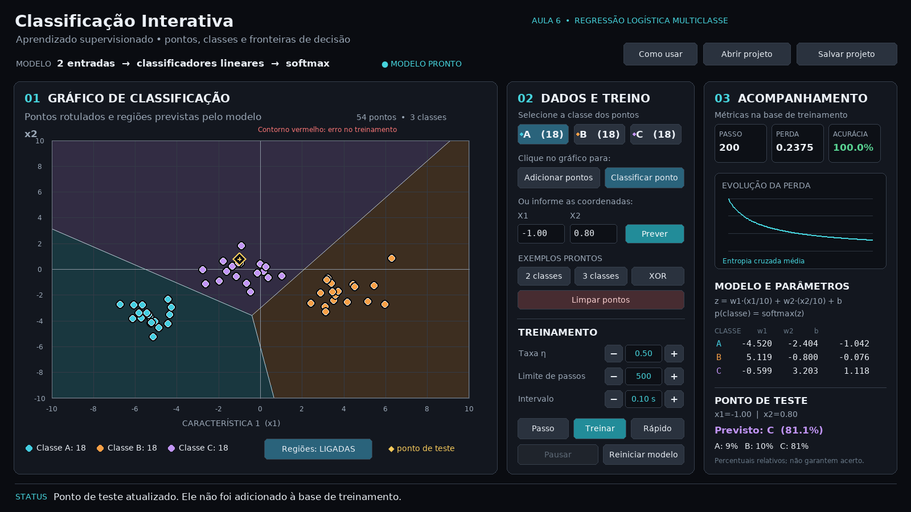

# Classificação Interativa — Aprendizado Supervisionado

Aplicação didática em Python para visualizar como um classificador aprende a atribuir **classes** a pontos em um gráfico de duas dimensões. Criada como material complementar de Introdução à Inteligência Artificial, com interface inspirada nos programas anteriores de busca, caracteres e regressão.



## O que o programa permite fazer

- Criar pontos de treinamento no gráfico com o mouse ou digitando as duas coordenadas `x1` e `x2`.
- Associar cada ponto à classe **A**, **B** ou **C** e treinar com duas ou três classes presentes.
- Carregar exemplos prontos de **duas classes**, **três classes** ou **XOR**.
- Acompanhar passo a passo o treinamento de uma **regressão logística multiclasse**, com saídas *softmax*.
- Ver as regiões previstas, suas fronteiras, os pontos de treinamento e os erros do modelo no mesmo gráfico.
- Configurar taxa de aprendizado, intervalo entre passos e limite de passos; executar um passo, treinar em velocidade controlada ou treinar rapidamente.
- Acompanhar a perda, a acurácia de treinamento e os pesos e vieses de cada classe.
- Classificar um **novo ponto de teste** sem adicioná-lo à base de treinamento.
- Salvar e abrir projetos em JSON, incluindo os pontos, o modelo e o histórico.

Ao iniciar, o programa carrega um conjunto sintético com 54 pontos distribuídos entre três classes. Você pode interpretar as duas coordenadas como características de objetos e as cores como categorias, mas os pontos não representam medições reais. O modelo começa sem treinamento: use **Passo**, **Treinar** ou **Rápido** para observar o aprendizado.

## Requisitos e instalação

O projeto usa **Python 3.10 a 3.14**, **NumPy** e **Pygame Community Edition (`pygame-ce`)**. O Pygame Community Edition fornece o módulo importado como `pygame`; ele é utilizado para oferecer compatibilidade com o Python 3.14 no Windows. Evite instalar `pygame` e `pygame-ce` simultaneamente no mesmo ambiente virtual.

É necessário um ambiente gráfico. A primeira instalação das bibliotecas usa internet; depois da instalação, o programa funciona localmente sem internet.

### Windows: usando o iniciador

1. Extraia o conteúdo do arquivo ZIP.
2. Abra a pasta `Classificacao_Interativa`.
3. Dê dois cliques em `INICIAR_WINDOWS.bat`.

Na primeira execução, o arquivo cria um ambiente virtual `.venv` e instala as dependências. Nas demais execuções, ele reutiliza o ambiente.

### Windows: instalando e executando manualmente

No PowerShell, dentro da pasta que contém `classificacao.py`:

```powershell
py -3 -m venv .venv
.\.venv\Scripts\python.exe -m pip install -r requirements.txt
.\.venv\Scripts\python.exe classificacao.py
```

Esses comandos usam diretamente o Python do ambiente virtual e não precisam ativá-lo no PowerShell. Se você já criou e ativou o ambiente, basta executar:

```powershell
python -m pip install -r requirements.txt
python classificacao.py
```

Execute o arquivo **`classificacao.py`**; ele importa automaticamente `modelo.py` e `dados.py`. Para usar os botões **Abrir projeto** e **Salvar projeto**, é necessário o Tkinter, normalmente incluído na instalação oficial do Python para Windows.

### Linux ou macOS

```bash
python3 -m venv .venv
.venv/bin/python -m pip install -r requirements.txt
.venv/bin/python classificacao.py
```

Em algumas distribuições Linux, o suporte a `venv` e Tkinter precisa ser instalado por meio do gerenciador de pacotes do sistema.

## Primeiro experimento em sala

1. Abra o programa. Os pontos já aparecem em três cores; elas representam as **classes corretas informadas no treinamento**.
2. Clique em **Passo**. Observe o primeiro ajuste das regiões e os pontos com contorno vermelho.
3. Clique em **Treinar**. Os pesos, a perda, a acurácia e as regiões são atualizados enquanto o modelo aprende. Use **Pausar** para interromper e **Treinar** para continuar.
4. Clique em **Classificar ponto** e depois em uma posição vazia do gráfico. O losango amarelo é o ponto de teste. O painel mostra a classe prevista e as saídas relativas das classes.
5. Mova o teste clicando em outros lugares, principalmente perto de uma fronteira. Compare as saídas de cada classe.
6. Clique em **XOR** e confirme a troca dos dados. Treine novamente e discuta por que um classificador linear não consegue separar perfeitamente esse conjunto.

Para um resultado rápido, use **Rápido**. Esse modo executa vários passos por atualização visual, mas mantém os dados de cada passo no histórico do projeto.

## Entendendo o gráfico

- O eixo horizontal é a **característica 1 (`x1`)**; o eixo vertical é a **característica 2 (`x2`)**. Cada eixo varia de −10 a 10.
- A cor de cada **ponto** representa o rótulo real informado para ele.
- A cor de fundo representa a **classe prevista pelo modelo** naquela região do gráfico.
- Uma linha clara é uma **fronteira de decisão** entre as classes que empatam com a maior saída. As linhas são calculadas a partir dos parâmetros do modelo.
- Um contorno vermelho destaca um ponto de treinamento cuja classe prevista é diferente da classe real.
- O losango amarelo indica um **ponto de teste**. Ele não modifica a base nem participa do treinamento.
- **Regiões: LIGADAS/DESLIGADAS** mostra ou esconde o fundo e as fronteiras.

O fundo é apresentado por uma malha de cores; as linhas de fronteira são calculadas a partir das equações do modelo. Perto de uma fronteira, pequenas variações nas coordenadas podem mudar a classe prevista.

## Criando seus próprios dados

1. Clique em **Limpar pontos** e confirme, caso queira começar uma base vazia.
2. Escolha a classe **A**, **B** ou **C** no painel **Dados e treino**.
3. Selecione **Adicionar pontos** e clique no gráfico para registrar exemplos daquela classe. Também é possível digitar `x1` e `x2` e clicar em **Adicionar**.
4. Repita a operação com outras classes. Para treinar, a base precisa ter pontos de **pelo menos duas classes diferentes**.
5. Para remover um ponto, clique com o botão direito próximo dele. A base comporta até **300 pontos**.

As coordenadas aceitas variam de −10 a 10. Ao digitar, use ponto ou vírgula como separador decimal. O programa avisa quando duas classes recebem exatamente as mesmas coordenadas: nesse caso, as entradas são iguais e os rótulos são contraditórios.

**Alterar a base depois de treinar reinicia o modelo e limpa o histórico**, pois os exemplos mudaram. Para preservar o trabalho, salve o projeto antes. Os botões de alteração da base ficam indisponíveis enquanto o treinamento está em execução; pause primeiro.

## Controles de treinamento

- **Taxa η:** tamanho da atualização de pesos e vieses. Valores maiores podem acelerar ou prejudicar o aprendizado.
- **Limite de passos:** número máximo de atualizações. Quando o limite é atingido, a execução para. Para continuar, aumente o limite ou reinicie o modelo.
- **Intervalo:** tempo entre atualizações na execução **Treinar**, com valores selecionáveis entre **0,01 e 5,00 segundos**. O intervalo real depende também do tempo de processamento e desenho da janela.
- **Passo:** executa uma atualização usando toda a base de treinamento.
- **Treinar:** executa passos automaticamente respeitando o intervalo escolhido.
- **Rápido:** executa pequenos lotes por quadro, permitindo acompanhar uma demonstração curta.
- **Pausar:** interrompe a execução sem perder o estado.
- **Reiniciar modelo:** reinicia pesos, vieses e histórico e mantém os pontos.

Quando nenhum campo de coordenada está selecionado, `Espaço` executa um passo e `Enter` inicia ou pausa o treinamento. O botão **Como usar** apresenta as instruções principais na própria janela.

## O que é calculado

O classificador usa duas características e um conjunto de saídas, uma por classe presente. Para cada classe `k`, ele calcula um escore:

```text
z_k = w1_k · (x1/10) + w2_k · (x2/10) + b_k
p_k = exp(z_k) / soma_j exp(z_j)
```

As coordenadas são divididas por 10 no cálculo para manter os valores em uma escala adequada ao exemplo. As saídas `p_k` somam 1. O modelo escolhe a classe de maior saída.

O erro exibido é a **entropia cruzada média** dos pontos de treinamento:

```text
J = −(1/n) · soma_i [log(p_i,classe_correta)]
```

A cada passo, todos os pontos são usados para calcular os gradientes e atualizar simultaneamente pesos e vieses:

```text
gradiente_w(j,k) = (1/n) · soma_i [(p_i,k − indicador_i,k) · x_i,j/10]
gradiente_b(k)   = (1/n) · soma_i [p_i,k − indicador_i,k]

w_novo = w_anterior − η · gradiente_w
b_novo = b_anterior − η · gradiente_b
```

O **indicador** vale 1 para a classe correta do ponto e 0 para as demais. A tabela do programa mostra os parâmetros após o último passo; os valores na tela são arredondados, enquanto os cálculos usam ponto flutuante.

## Como interpretar os resultados

A **acurácia mostrada é calculada com os próprios pontos usados no treinamento**. Ela não é uma avaliação em dados independentes. Ao testar um ponto desconhecido, sua classe correta não é informada ao programa, por isso o aplicativo mostra a previsão, mas não calcula uma acurácia de teste.

Os percentuais são saídas relativas da *softmax*. Eles não garantem que uma previsão esteja correta e não devem ser tratados como probabilidades calibradas. O modelo sempre escolhe uma das classes que recebeu durante o treinamento.

A regressão logística deste projeto produz regiões com fronteiras lineares. Por isso, é boa para demonstrar separações lineares, mas não resolve perfeitamente qualquer distribuição, como o exemplo XOR. Ele é um modelo didático; não há uma rede neural oculta nem treinamento, validação e teste separados automaticamente.

## Arquivos

- `classificacao.py`: janela, gráfico e controles.
- `modelo.py`: classificador softmax, função de perda, gradientes e fronteiras.
- `dados.py`: exemplos sintéticos e projetos JSON.
- `requirements.txt`: NumPy e pygame-ce.
- `INICIAR_WINDOWS.bat`: atalho para instalar e executar no Windows.
- `imagens/`: prévias da interface.
- `tests/`: testes do modelo e da interface.

Para executar os testes, depois de instalar as dependências:

```powershell
python -m unittest discover -s tests -v
```

Em Linux sem ambiente gráfico, use `SDL_VIDEODRIVER=dummy` e `SDL_AUDIODRIVER=dummy` para os testes de interface.
